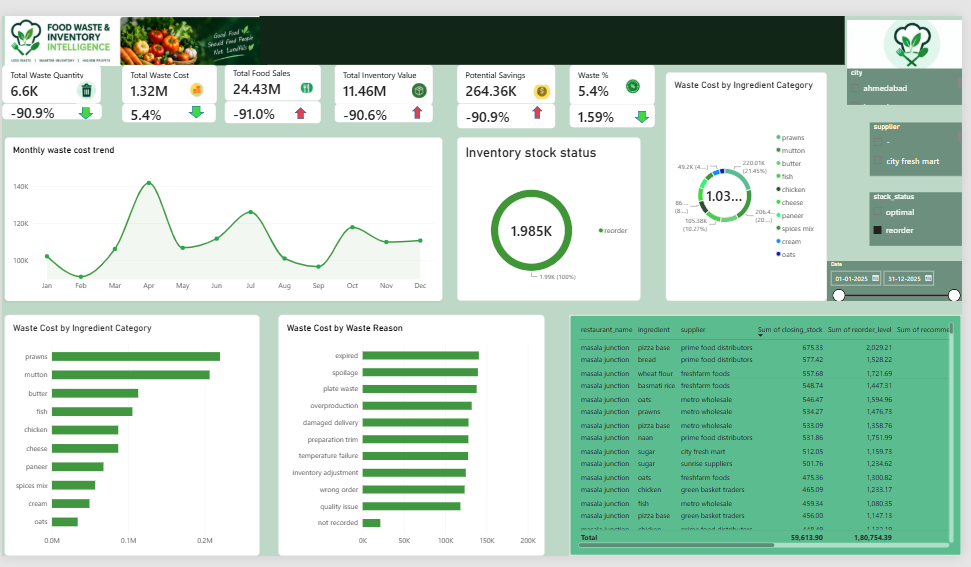

# Food Waste & Restaurant Inventory Optimization Intelligence

## Project Overview

This project analyzes restaurant food waste and inventory data to identify waste patterns, monitor expiry risks, optimize stock levels, and reduce avoidable food costs using Python and Power BI.

## Business Objectives

* Identify ingredients with the highest waste quantity and cost.
* Monitor inventory levels and stockout risks.
* Identify ingredients approaching expiry.
* Analyze waste by restaurant, ingredient category, and waste reason.
* Support data-driven inventory planning and cost reduction.

## Tools & Technologies

* **Python:** Data cleaning, exploratory data analysis, and inventory optimization.
* **Pandas & NumPy:** Data processing and calculations.
* **Matplotlib & Seaborn:** Data visualization.
* **Power BI:** Interactive dashboards and KPI reporting.
* **Git & GitHub:** Version control and project documentation.

## Project Workflow

1. Data collection and inspection
2. Data cleaning and validation
3. Exploratory data analysis (EDA)
4. Food waste and inventory analysis
5. Inventory optimization and expiry-risk analysis
6. Power BI dashboard development
7. Business insights and recommendations

## Key Business Questions

* Which ingredients contribute the most to food waste costs?
* Which categories and restaurants generate the most waste?
* Which ingredients are at risk of expiry?
* Which items need replenishment or have excess stock?
* Where can restaurants focus their waste-reduction efforts?

## Key Business Insights
Based on the analysis of 20,000 restaurant inventory records, the project identified the following business insights:

1. **High Food Waste Cost:** The dataset recorded a total calculated food waste cost of ₹1.39 crore, highlighting the financial impact of food waste on restaurant operations.

2. **Potential Cost Savings:** A hypothetical 20% reduction in calculated waste cost could save approximately ₹27.81 lakh. This is an estimated savings scenario, not a confirmed realized saving.

3. **Mutton Is the Highest-Cost Waste Ingredient:** Mutton contributed approximately ₹22.42 lakh in waste cost, making it the highest-cost ingredient among the five leading ingredients analyzed.

4. **Prawns and Fish Are Major Cost Drivers:** Prawns accounted for approximately ₹20.09 lakh, while fish contributed approximately ₹13.29 lakh in waste cost. These ingredients should be prioritized for waste monitoring and purchasing reviews.

5. **Dairy and Bakery Lead Category-Level Waste Quantity:** Dairy recorded approximately 12,890 units and bakery approximately 12,561 units of wasted quantity, based on the dataset's recorded units. These categories are key candidates for waste-reduction initiatives.

6. **Inventory Recommendations Need Calibration:** The current model classified 19,989 of 20,000 records (99.95%) as “REORDER SOON.” This unusually high proportion indicates that the reorder-point logic and demand assumptions should be validated before using the recommendations for operational decisions.

##  Business Recommendations

* Review purchasing quantities and usage patterns for mutton, prawns, and fish.
* Improve demand forecasting and preparation planning for high-waste ingredients.
* Apply FIFO (First In, First Out) and monitor expiry dates, especially for perishable inventory.
* Review dairy and bakery waste quantities and investigate recurring waste reasons.
* Validate average daily usage, supplier lead times, safety stock, and reorder thresholds.
* Track actual waste-cost reductions over time to measure whether the estimated savings opportunity is achieved.

## Repository Structure

* `data/` — Project datasets
* `python/` — Python scripts for cleaning, EDA, and optimization
* `images/` — Project visualizations
* `powerbi/` — Power BI dashboard files
* `requirements.txt` — Python dependencies

## Conclusion

This project demonstrates how Python-based data analysis and Power BI dashboards can help restaurants understand food waste, manage inventory more effectively, and make informed operational decisions.

## Dashboard Preview

